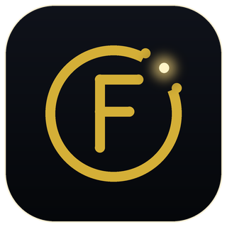
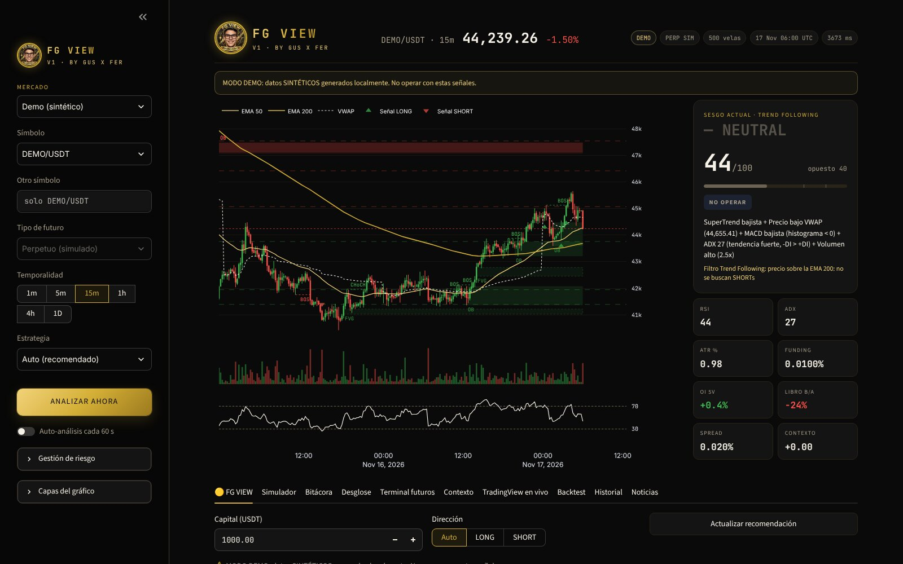
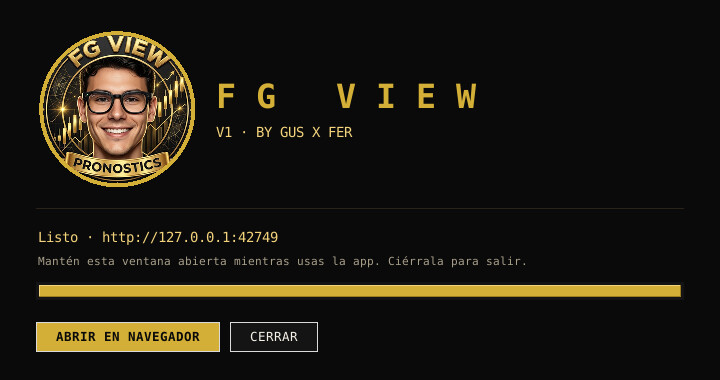

# FG ISRAEL VIEW · Build 1



**BY GUS X FER X ALFREDOBONUS** · Build 1 · Python + C++ (POO)

Sistema de **análisis** de mercados para operar **futuros**: cripto (perpetuos USDT-M y COIN-M en Binance, Bybit y OKX), acciones, ETFs y futuros CME. Lee la gráfica como un trader de Smart Money Concepts, combina 18 factores técnicos en un **score de 0 a 100**, añade el **contexto económico, social, político y cultural**, y te entrega un plan con entrada, Stop Loss, TP1 y TP2 calculados por riesgo.

> **No ejecuta órdenes.** Genera señales y alertas. La función `execute_order()` existe pero está desactivada a propósito. Los futuros apalancados pueden liquidar tu cuenta: nada de esto es consejo financiero.


<sub>Captura en modo Demo (datos sintéticos).</sub>

---

## 🕎 FG ISRAEL VIEW Build 1 (v4.0)

Rediseño con menú lateral por secciones y un interruptor **🎓 PRINCIPIANTE GOY / 🕎 EXPERTO RABBI**: en modo principiante cada módulo explica qué hace y cómo usarlo paso a paso y pliega las tablas técnicas; en modo experto se ve todo el detalle.

| Módulo | Clase (`engine/fgview/`) | Qué hace |
|---|---|---|
| 7 ⏳ Time Machine | `TimeMachine` (+ `fgcore.TimeMachine` en C++) | 100,000 simulaciones Monte Carlo: bootstrap por bloques de 15–30 min sobre 90 días de velas de 1 min, solo tramos con ATR ±20% del actual → P(TP1/TP2/TP3/SL/tiempo), expectativa, VaR 95% y veredicto ✅/⚠️/❌ |
| 8 📡 Chart Scanner | `ChartScanner` | Niveles A/B/C en 5m/15m/1h: cruce EMA 9/21, ruptura de 1h, rebote VWAP, divergencias RSI, volumen > 2×, squeeze → top 5 |
| 9 📰 News Monitor | `NewsMonitor` | Calendario + noticias cripto + exchanges con impacto y sentimiento; bloqueo ±30 min |
| 10 ⏱️ Entry Timer | `EntryTimer` | Cierre de vela de 5m, sesiones Londres/NY, funding, cancelación si el precio se aleja > 0.3 × ATR |
| 11 🛡️ Risk Manager | `RiskManager`, `PositionBook` | Stop diario, máx. 2 posiciones, sin correlacionadas en la misma dirección, liquidación ≥ 3× SL |
| 12 💰 Budget Manager | `BudgetManager` | Saldo real, riesgo a la mitad tras −10%, retiro del 20% cada +25% |
| 13 🤖 Order Executor | `OrderExecutor`, `PaperBroker`, `LiveBroker` | Papel por defecto; real semiautomático en Binance/Bybit con verificación de permisos (sin retiros, con IPs), margen aislado, SL + TPs reduce-only |
| 14 🔔 Alertas | `PriceAlerts` | Precio, cruce de EMAs, movimiento > 2% en 5 min, liquidación cerca; Telegram/webhook (`python -m engine.fgview.pricealerts`) |
| 15 💎 Fundamentales | `CryptoFundamentals` | Fees (DefiLlama), desbloqueos > 2% del circulante, quemas, ETFs y flujos (`data/crypto_fundamentals.json`) |
| 16 🐋 Smart Money | `SmartMoneyTracker` | Congreso de EE. UU. (STOCK Act) en COIN/MSTR/mineras/ETFs y ballenas (Whale Alert). Solo contexto |
| 🔥 BURN OUT | `BurnOutStrategy` | ⛔ Bolsa de quema ≤ 5% del capital, 50–100x en BTC/ETH, 25–50x nivel B, prohibido en memecoins, solo con P(TP1) ≥ 65% y señal ≥ 80, máx. 2 intentos/día, bloqueo 7 días si llega a $0, confirmación «CONFIRMO» |

Variables nuevas en `.env`: `LIVE_TRADING_ENABLED` (modo real, por defecto `false`), `QUIVER_API_KEY` y `WHALE_ALERT_API_KEY` (opcionales).

## ⚙️ Python + C++ (v3.4)

Los bucles más pesados están escritos en **C++** (`cpp/fgcore.cpp`), también con POO, y se usan desde Python con **pybind11**:

| Clase C++ | La usa | Qué acelera |
|---|---|---|
| `fgcore.TradeManager` | `engine/fgview/manager.py` | Gestión TP 50/30/20 sobre cientos de velas (estadística, validación, ROI objetivo): ~60× más rápido |
| `fgcore.LadderSimulator` | `engine/fgview/ladder.py` | Monte Carlo del crecimiento exponencial (miles de caminos) |

`engine/fgview/native.py` detecta si el núcleo está compilado; si no, se usa la versión Python con **exactamente** la misma lógica (lo comprueban los tests de paridad). `FGVIEW_NATIVE=0` fuerza Python.

Compilar el núcleo (necesitas un compilador C++: en Windows *Build Tools for Visual Studio* con "Desarrollo para el escritorio con C++"; en Mac `xcode-select --install`):

```bash
pip install pybind11==3.1.0
python setup_fgcore.py build_ext --inplace
```

En VS Code: **Terminal → Ejecutar tarea → 5. Compilar núcleo C++**.

## 🏗️ Arquitectura POO del motor FG VIEW (v3.3)

El motor vive en `engine/fgview/`: cada pieza es una clase con una sola responsabilidad y se conectan por inyección de dependencias en `FGServices` (`container.py`).

| Clase | Qué hace |
|---|---|
| `FGConfig` | Todos los parámetros (riesgo, filtros mínimos, tiempo máximo…) en un objeto |
| `TierCatalog` / `BudgetPolicy` | Niveles A/B/C y riesgo por capital |
| `SnapshotLoader` | Velas 5m + 1h con indicadores, **caché compartida** y **descarga en paralelo** |
| `Filter` (6 subclases) / `FilterSet` | Filtros y bloqueos: **una sola lógica** para la app en vivo y para la validación histórica |
| `PositionPlanner` | SL, TPs, apalancamiento, liquidación y R:R |
| `TradeManager` | La **única** gestión TP 50/30/20 (en vivo, estadística, validación y ROI objetivo) |
| `SetupStatistics` | Cómo le fue a *este* plan en situaciones parecidas |
| `ScalpRecommender` / `EasyModeAdvisor` | Recomendación y Modo fácil (con ROI objetivo) |
| `RecommenderBacktester` | Validación histórica: win rate real por confianza, sesión y filtro |
| `LadderPlanner` | Crecimiento exponencial sin liquidaciones |
| `TradeJournal` / `DailyGuard` | Bitácora y stop diario |

Para añadir un filtro basta con crear una subclase de `Filter` y añadirla a `DEFAULT_FILTERS`: la app, la estadística y la validación lo usan automáticamente.

## 📈 Crecimiento exponencial (v3.2)

Reto escalera **sin liquidaciones**: cada escalón usa margen aislado y un apalancamiento limitado para que la liquidación quede ≥ 3× más lejos que el Stop Loss (perder un escalón cuesta ~−8 %, nunca el 100 %). Una parte de cada ganancia va a una **caja fuerte** que ya no se arriesga y, tras 2 pérdidas seguidas, se arriesga la mitad. Compara con Monte Carlo la escalera **protegida** contra la **clásica** (todo dentro): probabilidad de llegar al objetivo, de quemar la cuenta y operaciones necesarias, con tu % de aciertos de la Bitácora.

## ✨ Modo fácil (v3.1)

Pones **solo tu capital** y pulsas **Buscar la mejor operación ahora**. FG VIEW revisa las criptos más líquidas y te dice en palabras simples qué hacer, cuánto poner, con qué apalancamiento, dónde ganar y dónde cortar pérdidas, con semáforo 🟢 entrar · 🟡 esperar · 🔴 no operar.

- **Probabilidad histórica**: en situaciones parecidas de los últimos días (EMA, VWAP y RSI a favor), cuántas veces el precio tocó cada TP antes que el SL en 30 minutos.
- **Valor esperado** por operación con esas probabilidades: solo sale 🟢 si las señales se cumplen, el R:R neto compensa y el valor esperado es positivo.
- **Pasos en Binance** uno a uno y **glosario** de todos los términos técnicos.

## 🟡 FG VIEW V1 · Recomendaciones de scalping (15–30 min)

La pestaña **🟡 FG VIEW** analiza la cripto elegida en velas de **5 min** (señal) y **1 h** (tendencia) y entrega un plan completo:

**Riesgo por capital**

| Capital | Riesgo por operación | Margen máximo |
|---|---|---|
| $50 – $100 | 2.0% | 30% |
| $100 – $500 | 1.5% | 25% |
| $500 – $2,000 | 1.0% | 20% |
| $2,000 – $10,000 | 0.75% | 15% |
| +$10,000 | 0.5% | 10% |

**Niveles por volatilidad**: A (BTC, ETH · 10–20x · SL 0.35%), B (SOL, BNB, XRP… · 5–10x · SL 0.70%), C (memecoins e IA · 3–5x · SL 1.20%). TPs al 50/30/20 %.

- **SL dinámico** = 1.2 × ATR(14) de 5 min (nunca menor que el de la tabla). Si la volatilidad amplía el SL, los **TPs se escalan** en la misma proporción para conservar el R:R.
- **Apalancamiento automático**: el mínimo del rango del nivel que respeta el margen máximo, y nunca tanto como para que la liquidación quede a menos de **3× la distancia del SL**.
- **6 filtros de entrada** (tendencia 1h, EMA 9/21, VWAP, RSI, volumen, funding + OI): solo recomienda entrar con **4 de 6** y R:R neto ≥ 1:1. **Bloqueos**: noticias de alto impacto, spread > 0.05%, mecha > 2× ATR, fin de semana flojo en Nivel C.
- **Comisiones visibles**: con SL tan cortos, la comisión taker puede ser ~30% del riesgo. Se muestra el **R:R neto** y se recomienda entrar con **orden límite** (maker).
- **Gestión**: TP1 50% + SL a break-even · TP2 30% + SL a TP1 · TP3 20% o trailing 0.5×ATR · salida a los 30 min · stop diario (3 pérdidas o −3%).
- **Bitácora**: registra cada operación; muestra win rate, profit factor, expectativa, drawdown, racha y qué filtros aciertan más. Valida el win rate con 30–50 operaciones antes de subir el riesgo.

---

## Qué hace

| Módulo | Detalle |
|---|---|
| **Datos** | CCXT (Binance → Bybit → OKX, con fallback automático a yfinance), yfinance para acciones/ETFs/CME, Open Interest, funding rate y libro de órdenes (spread, desequilibrio, muros), modo Demo sin internet |
| **Estructura SMC** | BOS, CHoCH, Order Blocks, Fair Value Gaps, soportes/resistencias, todo **causal** (sin mirar el futuro) |
| **Indicadores** | EMA 9/21/50/200, ADX, SuperTrend, RSI, MACD, Stoch RSI, Bollinger, ATR, VWAP, Volume Profile (POC/VAH/VAL), volumen relativo, divergencias RSI/MACD, envolventes, doji, martillo |
| **Score 0-100** | Suma ponderada de la confluencia según la estrategia. `<70` NO OPERAR · `70-85` esperar confirmación · `≥85` alta probabilidad + alerta |
| **Estrategias** | Trend Following, Scalping Futuros, Mean Reversion y Auto (elige según temporalidad y ADX) |
| **Riesgo** | SL = ATR×1.5 o bajo el Order Block · TP 1:2 y 1:3 · tamaño por % de riesgo · liquidación aprox. · contratos CME · filtro de noticias ±30 min · **kill switch** tras 3 pérdidas · **perfiles de capital** (bajo/medio/alto) con tope de apalancamiento que mantiene la liquidación detrás del SL |
| **Contexto** | VIX, dólar, bono 10y, S&P 500, inflación, tipos Fed, desempleo, curva de tipos (FRED), Fear & Greed, funding y titulares de Google News puntuados (económicos, políticos, sociales y culturales) |
| **Interfaz** | Streamlit oscura y minimalista: gráfico estilo TradingView, tarjeta de señal, terminal de futuros tipo exchange, TradingView en vivo, backtest, historial y noticias |
| **Simulador (Build 2)** | LONG/SHORT con tu capital: margen fijo o riesgo fijo %, TP1/TP2/TP3 parciales, ganancia y pérdida netas, ROI, impacto en la cuenta, liquidación, break-even, R:R, win rate mínimo, tabla de escenarios, comparación 5x/10x/20x/50x, alertas de riesgo y proyección de N operaciones con interés compuesto |
| **Backtest** | Motor nativo (mismas reglas que en vivo) y Backtrader con órdenes bracket |
| **API** | FastAPI (`/analyze`, `/signals`, `/kill-switch`...) |
| **Ejecutable** | `FGIsraelView.exe` con ventana de arranque propia, compilado por GitHub Actions |

---

## Instalación

### Opción A · Ejecutable de Windows (sin instalar Python)

1. Abre la pestaña **Actions** de este repositorio y entra en la última ejecución verde de *Build FGIsraelView.exe*.
2. En **Artifacts** descarga `FGIsraelView-Windows` y descomprímelo.
3. Doble clic en `FGIsraelView\FGIsraelView.exe`.



La carpeta debe quedarse completa (el `.exe` necesita `_internal` a su lado). Tu `.env` y tus datos se crean junto al `.exe`. Windows SmartScreen puede avisar porque el ejecutable no está firmado: *Más información → Ejecutar de todas formas*.

### Opción A2 · App de macOS Intel (macOS 12 Monterey o superior)

1. En **Actions**, abre la última ejecución verde y descarga el artifact `FGIsraelView-macOS-intel` (Macs con procesador **Intel**).
2. Abre el `.dmg` y arrastra **FGIsraelView** a la carpeta **Aplicaciones**.
3. La primera vez, en *Aplicaciones* haz **Control + clic** (o clic derecho) sobre FGIsraelView → **Abrir** → **Abrir**. Es necesario porque la app no está firmada por Apple.
   Si macOS dice que la app "está dañada", ejecuta esto en la Terminal y vuelve a abrirla:
   ```bash
   xattr -dr com.apple.quarantine /Applications/FGIsraelView.app
   ```

Tu `.env` y tus datos se guardan en `~/Library/Application Support/FGView`.

### Opción B · Doble clic con Python (Windows / Mac / Linux)

Necesitas [Python 3.11+](https://www.python.org/downloads/) (en Windows marca *Add python.exe to PATH*).

- **Windows:** doble clic en `INICIAR_WINDOWS.bat`
- **Mac / Linux:** `./iniciar_mac_linux.sh`

La primera vez crea el entorno e instala todo (unos minutos). Después arranca en segundos.

### Opción C · Terminal

```bash
git clone https://github.com/fershawty/xtremechiwas.git futures-scope
```

```bash
cd futures-scope
```

```bash
python -m venv .venv
```

Activa el entorno (Windows: `.venv\Scripts\activate` · Mac/Linux: `source .venv/bin/activate`) y luego:

```bash
pip install -r requirements.txt
```

```bash
cp .env.example .env
```

```bash
streamlit run app.py
```

Se abre en `http://localhost:8501`. Para probar sin internet elige el mercado **Demo (sintético)**.

---

## Otros comandos

API REST (documentación interactiva en `http://localhost:8000/docs`):

```bash
uvicorn api:app --reload --port 8000
```

Backtest desde la terminal (motor nativo o Backtrader, con gráfico PNG):

```bash
python tests/backtest_runner.py --market crypto --symbol BTC/USDT --timeframe 1h --limit 1500 --plot
```

```bash
python tests/backtest_runner.py --market demo --engine backtrader
```

Pruebas automáticas:

```bash
pytest -q
```

Compilar el `.exe` en tu propio PC: doble clic en `CONSTRUIR_EXE.bat`.

---

## Configuración (`.env`)

Todo es opcional; los valores por defecto funcionan. Lo más útil:

| Variable | Por defecto | Para qué |
|---|---|---|
| `ACCOUNT_EQUITY` / `RISK_PER_TRADE_PCT` | 1000 / 1.0 | Capital y % arriesgado por operación |
| `DEFAULT_LEVERAGE` | 5 | Apalancamiento para margen y liquidación |
| `ATR_SL_MULTIPLIER` · `TP1_RR` · `TP2_RR` | 1.5 · 2 · 3 | Stop y objetivos |
| `KILL_SWITCH_LOSSES` | 3 | Pérdidas seguidas que pausan el bot |
| `EXCHANGE_PRIORITY` | binance,bybit,okx | Orden de exchanges (Binance Futures está bloqueado en EE. UU.: el bot pasa solo al siguiente) |
| `CONTEXT_MAX_ADJUST` | 8 | Puntos máximos que el contexto suma o resta (0 = desactivar) |
| `NEWS_WINDOW_MINUTES` | 30 | Ventana sin operar alrededor de noticias de alto impacto |
| `TELEGRAM_BOT_TOKEN` / `TELEGRAM_CHAT_ID` | — | Alertas ≥85 en Telegram |
| `INDICATOR_BACKEND` | auto | `native`, `talib` o `pandas_ta` (opcionales en `requirements-optional.txt`) |

Las API keys de exchanges **no hacen falta** para analizar (los datos son públicos).

---

## Estructura

```
├── app.py                  Interfaz Streamlit
├── api.py                  API REST (FastAPI)
├── launcher.py             Lanzador de escritorio (se convierte en FGIsraelView.exe)
├── engine/
│   ├── config.py           Configuración (.env) y marca
│   ├── data_feeder.py      CCXT + yfinance + demo, OHLCV unificado
│   ├── indicators.py       Todo el stack técnico
│   ├── chart_analyzer.py   Estructura SMC (BOS, CHoCH, OB, FVG, S/R)
│   ├── signal_engine.py    Factores de confluencia y score 0-100
│   ├── risk_manager.py     SL/TP, tamaño, liquidación, kill switch, seguimiento
│   ├── context_analyzer.py Contexto económico, social, político y cultural
│   ├── news_filter.py      Filtro de noticias de alto impacto
│   ├── pipeline.py         Orquestador (lo usan la UI, la API y los tests)
│   ├── backtester.py       Backtest nativo
│   ├── database.py         SQLite (señales, estado, backtests)
│   ├── alerts.py           Telegram / webhook
│   └── order_executor.py   execute_order() DESACTIVADA
├── strategies/             trend_following · scalping_futures · mean_reversion
├── ui/                     components.py + styles.css
├── tests/                  test_engine.py + backtest_runner.py
├── data/news_calendar.json Calendario manual de noticias
└── futures_scope.spec      Receta del .exe (PyInstaller)
```

---

## Cómo modificar una estrategia en 3 pasos

1. **Abre** `strategies/trend_following.py` (o la que quieras). Todo lo que define una estrategia está en esa clase.
2. **Cambia los pesos** del diccionario `weights`: cuanto más alto, más pesa ese factor en el score. Por ejemplo, para dar más importancia al volumen y menos al ADX:
   ```python
   weights = {"structure": 15, "ema_trend": 15, "adx": 5, "volume": 11, ...}
   ```
   No hace falta que sumen 100 (el motor normaliza). Las claves válidas están en `engine/signal_engine.py → FACTORS`.
3. **Ajusta el filtro obligatorio** en `gate()` (por ejemplo `min_adx = 25` o una condición nueva). Guarda, pulsa **ANALIZAR AHORA** y comprueba el efecto en la pestaña **Backtest**.

Para crear una estrategia nueva, copia uno de los archivos, cambia `key`/`name` y regístrala en `strategies/__init__.py`: aparecerá sola en la interfaz, la API y el backtester.

---

## Cómo se calcula la señal

1. Cada factor devuelve, vela a vela, cuánto apoya un LONG y un SHORT (0 a 1).
2. **Score técnico** = suma ponderada con los pesos de la estrategia (los factores no disponibles, como el Open Interest en acciones, se excluyen y el resto se renormaliza).
3. Si no se cumple el **filtro** de la estrategia, el score se limita a 69.
4. El **contexto** suma o resta como máximo `CONTEXT_MAX_ADJUST` puntos (nunca salta el filtro).
5. **Noticias** de alto impacto o el **kill switch** bloquean la señal.
6. Si el score es ≥70 se guarda en SQLite y se sigue sola (TP1 = ganadora, SL = perdedora). Si es ≥85, además se envía una alerta.

---

## Contexto: alcance y límites

El contexto resume datos públicos con reglas simples y transparentes (los léxicos de sentimiento son editables en `engine/context_analyzer.py`). **No predice el mercado.** Lo "cultural" y lo "social" solo se pueden medir de forma indirecta (titulares, Fear & Greed, funding). Por eso el ajuste es pequeño y siempre visible: "Técnico 82 · contexto +4".

---

## Activar la ejecución real (futuro)

`engine/order_executor.py` contiene el código de referencia comentado para enviar órdenes con SL/TP vía CCXT. Antes de activarlo, prueba en **testnet**, usa API keys **sin permiso de retiro** y con IP en lista blanca, y empieza con el tamaño mínimo.

---

## Problemas frecuentes

- **"No se pudieron obtener datos"**: revisa el símbolo (cripto `BTC/USDT`, acciones `NVDA`, CME `ES=F`) y tu conexión. Binance Futures responde 451 desde EE. UU.: el bot usa Bybit/OKX automáticamente.
- **Yahoo limita peticiones**: espera un minuto o sube `DATA_CACHE_TTL_SECONDS`.
- **TA-Lib no instala**: es opcional, el motor nativo da los mismos resultados.
- **El `.exe` no abre**: revisa `data/launcher.log` junto al ejecutable.

---

**FG ISRAEL VIEW Build 1 · BY GUS X FER X ALFREDOBONUS** · Código abierto y editable. Gracias a **Alfredo Bonus** por su ayuda.
