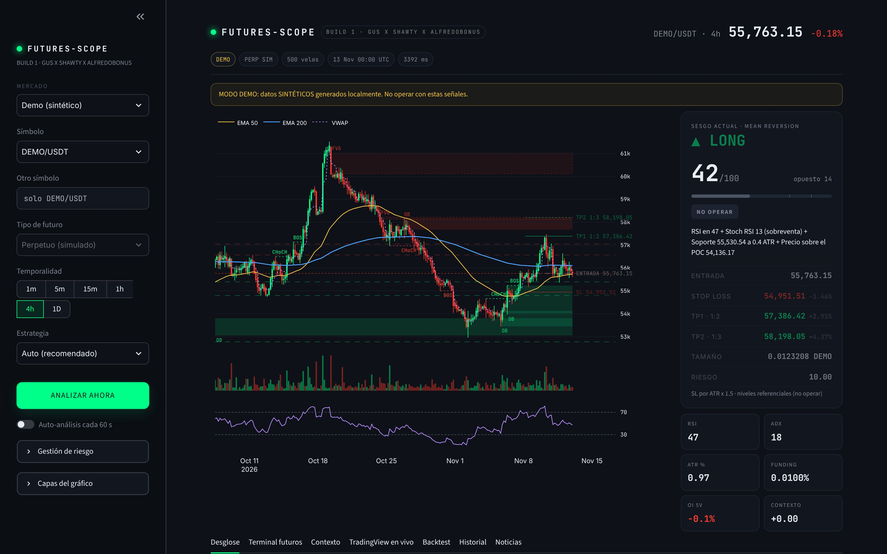
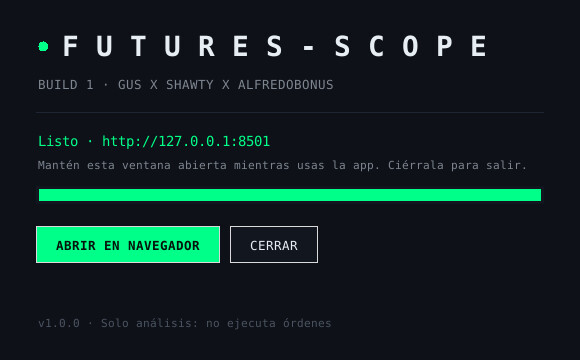

# FUTURES-SCOPE

**BUILD 1 · GUS X SHAWTY X ALFREDOBONUS**

Sistema de **análisis** de mercados para operar **futuros**: cripto (perpetuos USDT-M y COIN-M en Binance, Bybit y OKX), acciones, ETFs y futuros CME. Lee la gráfica como un trader de Smart Money Concepts, combina 18 factores técnicos en un **score de 0 a 100**, añade el **contexto económico, social, político y cultural**, y te entrega un plan con entrada, Stop Loss, TP1 y TP2 calculados por riesgo.

> **No ejecuta órdenes.** Genera señales y alertas. La función `execute_order()` existe pero está desactivada a propósito. Los futuros apalancados pueden liquidar tu cuenta: nada de esto es consejo financiero.


<sub>Captura en modo Demo (datos sintéticos).</sub>

---

## Qué hace

| Módulo | Detalle |
|---|---|
| **Datos** | CCXT (Binance → Bybit → OKX, con fallback automático a yfinance), yfinance para acciones/ETFs/CME, Open Interest y funding rate, modo Demo sin internet |
| **Estructura SMC** | BOS, CHoCH, Order Blocks, Fair Value Gaps, soportes/resistencias, todo **causal** (sin mirar el futuro) |
| **Indicadores** | EMA 9/21/50/200, ADX, SuperTrend, RSI, MACD, Stoch RSI, Bollinger, ATR, VWAP, Volume Profile (POC/VAH/VAL), volumen relativo, divergencias RSI/MACD, envolventes, doji, martillo |
| **Score 0-100** | Suma ponderada de la confluencia según la estrategia. `<70` NO OPERAR · `70-85` esperar confirmación · `≥85` alta probabilidad + alerta |
| **Estrategias** | Trend Following, Scalping Futuros, Mean Reversion y Auto (elige según temporalidad y ADX) |
| **Riesgo** | SL = ATR×1.5 o bajo el Order Block · TP 1:2 y 1:3 · tamaño por % de riesgo · liquidación aprox. · contratos CME · filtro de noticias ±30 min · **kill switch** tras 3 pérdidas |
| **Contexto** | VIX, dólar, bono 10y, S&P 500, inflación, tipos Fed, desempleo, curva de tipos (FRED), Fear & Greed, funding y titulares de Google News puntuados (económicos, políticos, sociales y culturales) |
| **Interfaz** | Streamlit oscura y minimalista: gráfico estilo TradingView, tarjeta de señal, terminal de futuros tipo exchange, TradingView en vivo, backtest, historial y noticias |
| **Backtest** | Motor nativo (mismas reglas que en vivo) y Backtrader con órdenes bracket |
| **API** | FastAPI (`/analyze`, `/signals`, `/kill-switch`...) |
| **Ejecutable** | `FuturesScope.exe` con ventana de arranque propia, compilado por GitHub Actions |

---

## Instalación

### Opción A · Ejecutable de Windows (sin instalar Python)

1. Abre la pestaña **Actions** de este repositorio y entra en la última ejecución verde de *Build FuturesScope.exe*.
2. En **Artifacts** descarga `FuturesScope-Windows` y descomprímelo.
3. Doble clic en `FuturesScope\FuturesScope.exe`.



La carpeta debe quedarse completa (el `.exe` necesita `_internal` a su lado). Tu `.env` y tus datos se crean junto al `.exe`. Windows SmartScreen puede avisar porque el ejecutable no está firmado: *Más información → Ejecutar de todas formas*.

### Opción A2 · App de macOS (Sonoma 14 o superior)

1. En **Actions**, abre la última ejecución verde y descarga el artifact de tu Mac:
   - `FuturesScope-macOS-apple-silicon` → Macs con chip **M1, M2, M3 o M4**
   - `FuturesScope-macOS-intel` → Macs con procesador **Intel** (build experimental)

   ¿No sabes cuál tienes? Menú  → *Acerca de este Mac*: si pone **Chip Apple M…** es Apple Silicon; si pone **Procesador Intel**, Intel.
2. Abre el `.dmg` y arrastra **FuturesScope** a la carpeta **Aplicaciones**.
3. La primera vez, en *Aplicaciones* haz **Control + clic** (o clic derecho) sobre FuturesScope → **Abrir** → **Abrir**. Es necesario porque la app no está firmada por Apple.
   Si macOS dice que la app "está dañada", ejecuta esto en la Terminal y vuelve a abrirla:
   ```bash
   xattr -dr com.apple.quarantine /Applications/FuturesScope.app
   ```

Tu `.env` y tus datos se guardan en `~/Library/Application Support/FuturesScope`.

### Opción B · Doble clic con Python (Windows / Mac / Linux)

Necesitas [Python 3.11+](https://www.python.org/downloads/) (en Windows marca *Add python.exe to PATH*).

- **Windows:** doble clic en `INICIAR_WINDOWS.bat`
- **Mac / Linux:** `./iniciar_mac_linux.sh`

La primera vez crea el entorno e instala todo (unos minutos). Después arranca en segundos.

### Opción C · Terminal

```bash
git clone https://github.com/fershawty/xtremechiwas.git futures-scope
```

```bash
cd futures-scope
```

```bash
python -m venv .venv
```

Activa el entorno (Windows: `.venv\Scripts\activate` · Mac/Linux: `source .venv/bin/activate`) y luego:

```bash
pip install -r requirements.txt
```

```bash
cp .env.example .env
```

```bash
streamlit run app.py
```

Se abre en `http://localhost:8501`. Para probar sin internet elige el mercado **Demo (sintético)**.

---

## Otros comandos

API REST (documentación interactiva en `http://localhost:8000/docs`):

```bash
uvicorn api:app --reload --port 8000
```

Backtest desde la terminal (motor nativo o Backtrader, con gráfico PNG):

```bash
python tests/backtest_runner.py --market crypto --symbol BTC/USDT --timeframe 1h --limit 1500 --plot
```

```bash
python tests/backtest_runner.py --market demo --engine backtrader
```

Pruebas automáticas:

```bash
pytest -q
```

Compilar el `.exe` en tu propio PC: doble clic en `CONSTRUIR_EXE.bat`.

---

## Configuración (`.env`)

Todo es opcional; los valores por defecto funcionan. Lo más útil:

| Variable | Por defecto | Para qué |
|---|---|---|
| `ACCOUNT_EQUITY` / `RISK_PER_TRADE_PCT` | 1000 / 1.0 | Capital y % arriesgado por operación |
| `DEFAULT_LEVERAGE` | 5 | Apalancamiento para margen y liquidación |
| `ATR_SL_MULTIPLIER` · `TP1_RR` · `TP2_RR` | 1.5 · 2 · 3 | Stop y objetivos |
| `KILL_SWITCH_LOSSES` | 3 | Pérdidas seguidas que pausan el bot |
| `EXCHANGE_PRIORITY` | binance,bybit,okx | Orden de exchanges (Binance Futures está bloqueado en EE. UU.: el bot pasa solo al siguiente) |
| `CONTEXT_MAX_ADJUST` | 8 | Puntos máximos que el contexto suma o resta (0 = desactivar) |
| `NEWS_WINDOW_MINUTES` | 30 | Ventana sin operar alrededor de noticias de alto impacto |
| `TELEGRAM_BOT_TOKEN` / `TELEGRAM_CHAT_ID` | — | Alertas ≥85 en Telegram |
| `INDICATOR_BACKEND` | auto | `native`, `talib` o `pandas_ta` (opcionales en `requirements-optional.txt`) |

Las API keys de exchanges **no hacen falta** para analizar (los datos son públicos).

---

## Estructura

```
├── app.py                  Interfaz Streamlit
├── api.py                  API REST (FastAPI)
├── launcher.py             Lanzador de escritorio (se convierte en FuturesScope.exe)
├── engine/
│   ├── config.py           Configuración (.env) y marca
│   ├── data_feeder.py      CCXT + yfinance + demo, OHLCV unificado
│   ├── indicators.py       Todo el stack técnico
│   ├── chart_analyzer.py   Estructura SMC (BOS, CHoCH, OB, FVG, S/R)
│   ├── signal_engine.py    Factores de confluencia y score 0-100
│   ├── risk_manager.py     SL/TP, tamaño, liquidación, kill switch, seguimiento
│   ├── context_analyzer.py Contexto económico, social, político y cultural
│   ├── news_filter.py      Filtro de noticias de alto impacto
│   ├── pipeline.py         Orquestador (lo usan la UI, la API y los tests)
│   ├── backtester.py       Backtest nativo
│   ├── database.py         SQLite (señales, estado, backtests)
│   ├── alerts.py           Telegram / webhook
│   └── order_executor.py   execute_order() DESACTIVADA
├── strategies/             trend_following · scalping_futures · mean_reversion
├── ui/                     components.py + styles.css
├── tests/                  test_engine.py + backtest_runner.py
├── data/news_calendar.json Calendario manual de noticias
└── futures_scope.spec      Receta del .exe (PyInstaller)
```

---

## Cómo modificar una estrategia en 3 pasos

1. **Abre** `strategies/trend_following.py` (o la que quieras). Todo lo que define una estrategia está en esa clase.
2. **Cambia los pesos** del diccionario `weights`: cuanto más alto, más pesa ese factor en el score. Por ejemplo, para dar más importancia al volumen y menos al ADX:
   ```python
   weights = {"structure": 15, "ema_trend": 15, "adx": 5, "volume": 11, ...}
   ```
   No hace falta que sumen 100 (el motor normaliza). Las claves válidas están en `engine/signal_engine.py → FACTORS`.
3. **Ajusta el filtro obligatorio** en `gate()` (por ejemplo `min_adx = 25` o una condición nueva). Guarda, pulsa **ANALIZAR AHORA** y comprueba el efecto en la pestaña **Backtest**.

Para crear una estrategia nueva, copia uno de los archivos, cambia `key`/`name` y regístrala en `strategies/__init__.py`: aparecerá sola en la interfaz, la API y el backtester.

---

## Cómo se calcula la señal

1. Cada factor devuelve, vela a vela, cuánto apoya un LONG y un SHORT (0 a 1).
2. **Score técnico** = suma ponderada con los pesos de la estrategia (los factores no disponibles, como el Open Interest en acciones, se excluyen y el resto se renormaliza).
3. Si no se cumple el **filtro** de la estrategia, el score se limita a 69.
4. El **contexto** suma o resta como máximo `CONTEXT_MAX_ADJUST` puntos (nunca salta el filtro).
5. **Noticias** de alto impacto o el **kill switch** bloquean la señal.
6. Si el score es ≥70 se guarda en SQLite y se sigue sola (TP1 = ganadora, SL = perdedora). Si es ≥85, además se envía una alerta.

---

## Contexto: alcance y límites

El contexto resume datos públicos con reglas simples y transparentes (los léxicos de sentimiento son editables en `engine/context_analyzer.py`). **No predice el mercado.** Lo "cultural" y lo "social" solo se pueden medir de forma indirecta (titulares, Fear & Greed, funding). Por eso el ajuste es pequeño y siempre visible: "Técnico 82 · contexto +4".

---

## Activar la ejecución real (futuro)

`engine/order_executor.py` contiene el código de referencia comentado para enviar órdenes con SL/TP vía CCXT. Antes de activarlo, prueba en **testnet**, usa API keys **sin permiso de retiro** y con IP en lista blanca, y empieza con el tamaño mínimo.

---

## Problemas frecuentes

- **"No se pudieron obtener datos"**: revisa el símbolo (cripto `BTC/USDT`, acciones `NVDA`, CME `ES=F`) y tu conexión. Binance Futures responde 451 desde EE. UU.: el bot usa Bybit/OKX automáticamente.
- **Yahoo limita peticiones**: espera un minuto o sube `DATA_CACHE_TTL_SECONDS`.
- **TA-Lib no instala**: es opcional, el motor nativo da los mismos resultados.
- **El `.exe` no abre**: revisa `data/launcher.log` junto al ejecutable.

---

**FUTURES-SCOPE · BUILD 1 · GUS X SHAWTY X ALFREDOBONUS** · Código abierto y editable.
